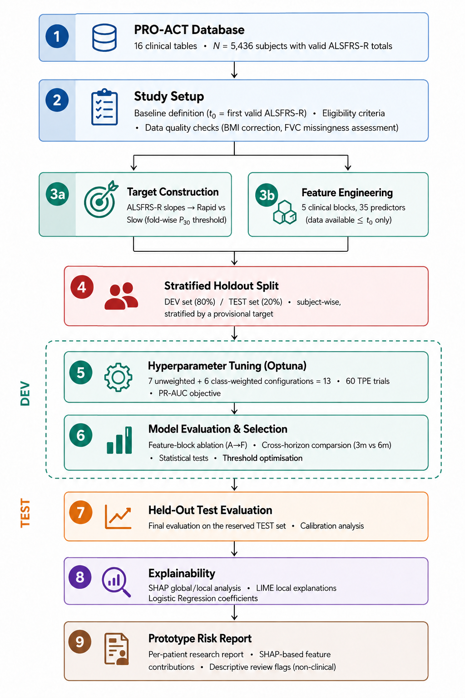
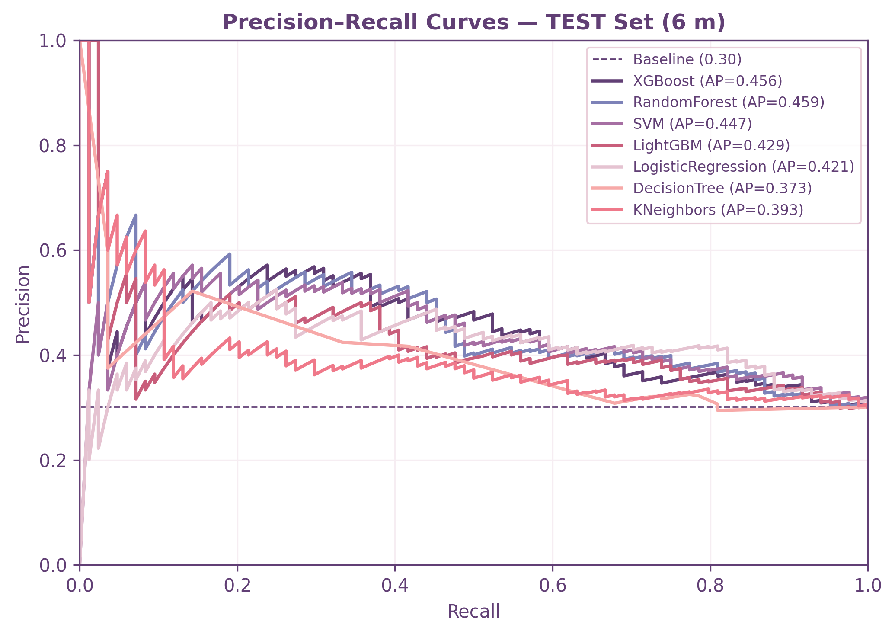
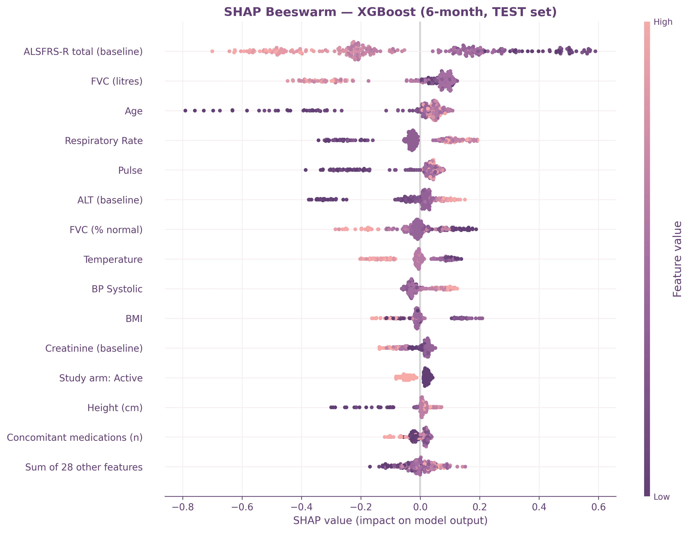

# Explainable ALS Functional Progression

Code for **Study I** of Ivo Nunes Camacho's MSc dissertation, *Explainable and Reproducible Machine Learning for ALS Prognosis: Functional Progression Classification and Survival Prediction*, supervised by Maryam Abbasi and Pedro Martins at the Polytechnic University of Santarem.

The study classifies rapid functional decline at three and six months using PRO-ACT clinical-trial records. Baseline predictors are separated in time from the follow-up observations used to estimate ALSFRS-R slopes. Model development also separates patients, estimates target cutoffs within training data, and selects a decision threshold from development predictions.



## Study design

| Component | Definition |
|---|---|
| Outcome | Rapid versus slow ALSFRS-R decline at 90 or 180 days |
| Baseline | Earliest valid ALSFRS-R total score and assessment date |
| Target | Ordinary least-squares slope, expressed in points per 30 days |
| Eligibility | An assessment within the endpoint band of +/-7 days and at least two distinct assessment times |
| Cohorts | 2,407 patients at three months; 1,392 at six months |
| Predictors | 35 baseline clinical features in the final v2 dataset |
| Classifiers | KNN, Decision Tree, Random Forest, SVM, Logistic Regression, LightGBM, XGBoost |
| Imbalance conditions | Unbalanced and balanced modes where supported; 13 configurations at six months |
| Model selection | Optuna optimisation of cross-validated PR-AUC (average precision) |
| Validation | Patient-level 80/20 split and grouped five-fold cross-validation within development data |
| Explanations | SHAP, LIME, and logistic-regression coefficients |

Later clinical records do not enter the baseline feature matrix. During cross-validation, the 30th-percentile slope cutoff is estimated from each training fold. Held-out labels use the development-partition cutoff. Global labels are used only to stratify the initial split, not as the modelling targets. Imputation and any feature scaling are fitted within the training data.

## Reported results

These values are the dissertation results, not results from a new run of this repository.

| Six-month XGBoost result | Value |
|---|---|
| Mean development CV PR-AUC | 0.434 |
| Held-out PR-AUC | 0.456, 95% CI [0.364, 0.568] |
| Held-out patients | 279, including 84 rapid progressors |
| Development-selected threshold | 0.21 |
| Recall at that threshold | 85.7% (72/84) |
| Precision at that threshold | 35.1% |
| False positives | 133 |



The threshold maximises development F1 and is an exploratory operating point. Its high recall comes with many false positives; no clinical cost matrix or intervention was specified. PR-AUC describes score ranking and should be interpreted alongside the confusion matrix and threshold-dependent metrics.

Baseline ALSFRS-R and FVC had the largest global SHAP contributions. FVC in litres was missing for 43.7% of the six-month cohort, so its attribution must be read alongside the missing-data analysis. The supplementary scripts examine feature ablation, calibration, subgroup errors, decision curves, learning curves, bootstrap intervals, partial dependence, and imputation sensitivity.



## Repository layout

```text
01_data/
  raw/               Authorised PRO-ACT CSV files, stored locally
  interim/           Baseline table and follow-up targets, generated locally
  processed/         Feature tables, datasets and split manifests, generated locally
02_notebooks/        Target construction, baseline feature assembly and development notebooks
03_src/
  data/              Baseline construction, dataset assembly, cleaning and fixed splits
  tuning/            Unified Optuna search; archive_v1 contains earlier tuning scripts
  evaluation/        Held-out evaluation and development-only threshold selection
  analysis/          Explainability, figures and supplementary analyses
  training/          Full-cohort prototype model fitting
  report/            Prototype report and synthetic-profile generators
04_outputs/          Generated tables and figures, stored locally
models/              Locally generated fitted-model artefacts
assets/              Selected published figures used in this README
requirements.txt     Python dependencies
```

## Installation

Use Python 3.12 (verified locally with 3.12.10). From the repository root:

```bash
python -m venv .venv
# Windows PowerShell: .venv\Scripts\Activate.ps1
# Linux/macOS: source .venv/bin/activate
python -m pip install --upgrade pip
python -m pip install -r requirements.txt
```

The original environment was not archived as a historical lock. Core dependencies in `requirements.txt` are now pinned to the Python 3.12.10 environment inspected on 23 October 2026. `requirements-verified.txt` records its full installed-package inventory, including transitive and development dependencies. This snapshot does not establish the environment at the time of every original run, or guarantee bitwise agreement across platforms. Exact partition reproduction also requires the original row order and verification against the split manifests described below.

The scripts do not require a notebook interface. For optional notebook execution/export, install `requirements-notebooks.txt` after the core requirements; those interface tools were not part of the verified runtime snapshot.

## Data preparation

Obtain authorised access through the [PRO-ACT platform](https://ncri1.partners.org/proact) and place the original `PROACT_*.csv` tables in `01_data/raw/`. The analysis uses the extract's original column names.

Run the following from the repository root. The two notebooks execute from `02_notebooks/`, because their paths are relative to that directory. Executed copies are written to the ignored output directory.

```bash
python 03_src/data/build_baseline.py
cd 02_notebooks
jupyter nbconvert --to notebook --execute --ExecutePreprocessor.timeout=-1 --output-dir ../04_outputs/executed_notebooks 01a_step3_build_targets.ipynb
jupyter nbconvert --to notebook --execute --ExecutePreprocessor.timeout=-1 --output-dir ../04_outputs/executed_notebooks 02_step4_build_features.ipynb
cd ..
python 03_src/data/build_datasets_v1.py
python 03_src/data/build_features_v2.py
python 03_src/data/fix_vitals_and_rebuild.py
python 03_src/data/create_holdout_split.py
```

`build_baseline.py` reconstructs the original 5,436-row baseline table. `build_datasets_v1.py` retains the feature-table ordering used for the original seeded split and prefers the original `baseline_with_targets_step3_nolabels.csv` when that authorised local artefact is available. Otherwise it uses the newly generated v2 target file. Final model development uses the v2 predictors.

For an exact reproduction of the dissertation's patient assignments, retain the original local split manifests. The split script preserves existing valid manifests instead of overwriting them. Recreating slopes can introduce floating-point differences around the 30th-percentile boundary: two near-tied three-month slopes differed in the available target exports, which changes their stratification labels and can change the seeded split. Row ordering also matters. The repository preserves the analysis algorithm but does not distribute the patient-level artefacts needed to guarantee identical historical assignments.

The source notebooks contain no saved outputs. Some additional notebooks and `tuning/archive_v1/` record earlier development experiments; they are not the execution path for the final held-out results. `02b_step4_build_features_v2.ipynb` provides the notebook counterpart of v2 feature assembly, while the sequence above uses the scripts.

## Primary analysis

Run scripts from the repository root:

```bash
python 03_src/tuning/optuna_tune_all.py --horizon 6m
python 03_src/tuning/optuna_tune_all.py --horizon 3m --models LR RF LGBM XGB
python 03_src/evaluation/evaluate_holdout.py
python 03_src/analysis/step8_explainability.py
```

The tuning script accepts `--help`, `--models`, `--trials` and `--unbalanced-only`. Six-month tuning covers all 13 supported configurations. The three-month command reproduces the four model families used in the cross-horizon comparison. Held-out evaluation and the main explainability script use the six-month cohort.

## Supplementary analyses

After preparing the data and completing tuning:

```bash
python 03_src/data/analyze_fvc_missingness.py
python 03_src/analysis/ablation_v2.py
python 03_src/analysis/step7_statistical_comparison.py
python 03_src/analysis/step9_supplementary_analyses.py
python 03_src/analysis/missing_data_sensitivity.py
python 03_src/analysis/generate_study1_eda_figures.py
python 03_src/analysis/generate_step5_visuals.py
python 03_src/analysis/generate_3m_vs_6m_visuals.py
```

The `training/` and `report/` scripts support the dissertation's reporting prototype. Those training scripts fit the complete cohort and must not be used to produce the held-out evaluation. The primary evaluation and explainability scripts fit their models on development patients only.

Some figure scripts also create an `overleaf/` directory with duplicate figure exports. A LaTeX project is not required to run the analyses.

## Reviewer follow-up checks

After generating the original datasets, split manifests, tuning histories and
held-out predictions, run:

```bash
python 03_src/analysis/reviewer_followup.py
```

This supplementary script reads the locally retained predictions from Step 8. It
checks the test identifiers, labels and confusion matrix before computing baseline
and selection summaries, subgroup recall intervals, decision-curve intervals,
scaled Brier score, descriptive calibration diagnostics, encoding summaries and
the Study I trial-history audit. It writes aggregate outputs to
`04_outputs/reviewer_followup/` and never refits a predictive model. Bootstrap
intervals use 2,000 resamples by default (`--bootstrap`). `--project-root` and
`--output` can point to another authorised local study directory and output path.
The assertions intentionally check the dissertation's cohorts and original split;
they should not be weakened to make a different data extract appear identical.

The threshold plot now leaves precision undefined when no positive prediction is
made; the selected thresholds are unchanged. The LR coefficient plot has extra
space for negative value labels. These are display corrections, not model changes.

Patient separation does not establish independence between source trials. The
original five-fold design was not replaced with repeated stratified CV. Race
indicators retain their original numeric median imputation, and LIME's original
perturbation scheme was not replaced with categorical-aware explanations. These
limitations remain relevant when interpreting the results.

## Data use and limitations

This repository distributes code and selected published figures. Source data, patient-level derivatives, predictions, profiles, explanation matrices and fitted models remain local and are ignored by Git. PRO-ACT access and reuse remain subject to its [terms and conditions](https://ncri1.partners.org/ProACT/Document/DisplayLatest/1); the code licence does not grant permission to redistribute those records.

The study is secondary analysis of de-identified trial records, with no new participant recruitment or clinical data collection. Its results provide internal validation in PRO-ACT. External and prospective evaluation, calibration and an explicit clinical decision objective are needed before clinical use.

## Related work and licence

The source snapshot comes from the [dissertation repository](https://github.com/NotAnnieMore/ALSThesis) at commit `6e54223`, with standalone preparation helpers and path corrections. The companion survival study is available in [als-survival-imbalance-ml](https://github.com/Applied-Intelligence-Hub/als-survival-imbalance-ml).

The repository retains the GNU GPL v3 [licence](LICENSE) supplied by Applied Intelligence Hub.
